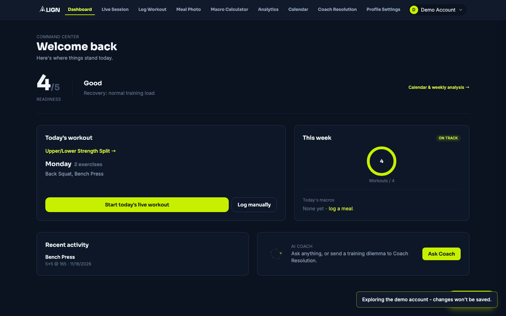
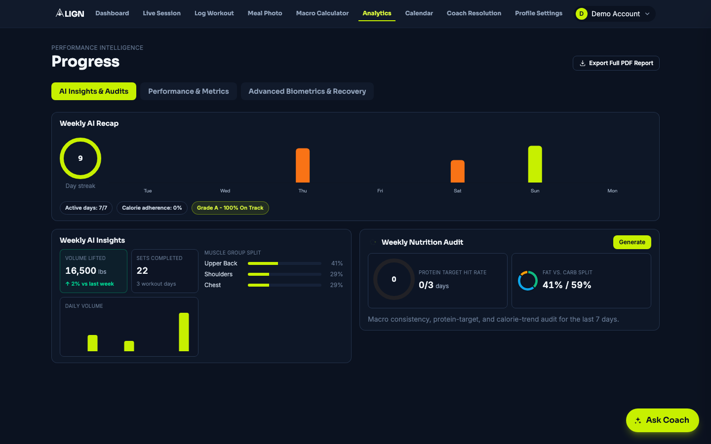
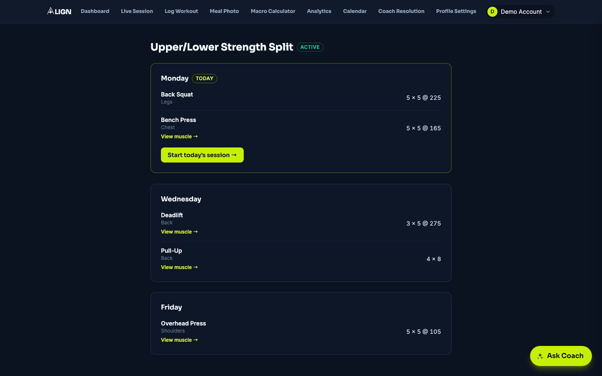
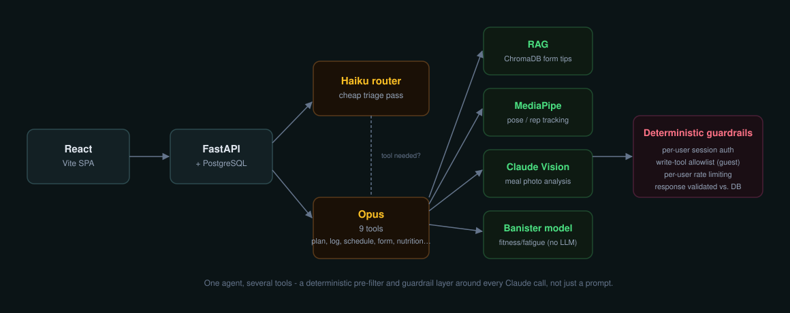

# ALIGN

**A coach that watches, listens, and adapts.**

A full-stack AI fitness coaching app I designed, built, and deployed solo: a Claude-powered conversational agent paired with computer vision, a from-scratch retrieval-augmented generation (RAG) pipeline, and deterministic physiological modeling.

[](https://github.com/murugeshmithuna/align/actions/workflows/tests.yml)
[](https://fitness-agent-sigma.vercel.app)
[](https://fitness-agent-sigma.vercel.app/demo)

Live frontend: [fitness-agent-sigma.vercel.app](https://fitness-agent-sigma.vercel.app) (first load can take up to a minute - free-tier backend)
Live backend: `fitness-agent-wuvh.onrender.com`

**[Try the demo →](https://fitness-agent-sigma.vercel.app/demo)** - one click, no Google sign-in, lands straight on a dashboard seeded with three weeks of workout/check-in/meal history. The account is genuine but read-only: every write it attempts is blocked server-side (`backend/app/guest.py`), not just hidden in the UI.



<details>
<summary>More screenshots (Analytics, Plan Detail)</summary>




</details>

## Architecture



One agent, several deterministic tools - a cheap Haiku pass routes every message, only calling the heavier Opus reasoner when a tool is actually needed. Every tool's input/output is a forced, strict JSON schema (`additionalProperties: false`), and anything genuinely computable - the Banister fitness/fatigue model, calorie estimates, PR detection - is plain Python the model narrates, never arithmetic it's trusted to do itself. On top of that sits a layer of guardrails that don't depend on the model behaving: per-user session auth (`backend/app/user_auth.py`), a hard write-tool block for the shared guest account enforced at the single tool-execution chokepoint rather than in the prompt (`backend/app/guest.py`), and per-user rate limiting (`backend/app/rate_limit.py`).

## Results

Every number below is measured directly and reproducible from this repo - nothing here is invented.

| Metric | Result | How it's measured |
|---|---|---|
| Backend tests passing | **67/67** | `cd backend && pytest` - also runs in CI on every push ([`tests.yml`](.github/workflows/tests.yml)) |
| RAG retrieval precision@1 | **92% (12/13)** | `backend/scripts/eval_retrieval.py` - 13 knowledge-base docs, natural-language queries, against the committed ChromaDB index at the 0.4 distance threshold. One disclosed miss (see below) |
| RAG retrieval specificity | **100% (7/7)** | Same script - 7 genuinely unrelated queries (recipes, weather, geography), confirming they're correctly filtered out, not matched to the nearest exercise doc anyway |
| Router tool-selection accuracy | **82% (41/50)** | `backend/scripts/eval_router.py`, 50 labeled cases across all 9 tools + plain-conversation - see note below |
| Avg. Claude calls per chat turn | **2.0** | 4 real chat turns sampled locally (see note below) - 2 answered directly by the fast router with no tool needed, 2 needed the full router + reasoning-pass loop |
| Cost per chat turn | **$0.090 avg** (range $0.003–$0.183) | Same sample - direct-answer turns cost a few tenths of a cent (Haiku only); tool-calling turns cost ~18x more (Opus reasoning + tool execution) |
| Latency (p50 / p95) | **1.3s / 9.2s** | Across all 11 real Claude calls in the sample, chat and recap/digest/review endpoints combined |

**How the router number was actually produced, and a real bug it found:** running the eval live surfaced a genuine production bug, not just a score - `ROUTING_TOOL`'s `tool_name` enum never declared `redirect_to_coach_resolution` as an option, but the system prompt tells the fast router to call it anyway for any plan-change request. The model sometimes complies literally (an enum violation the API doesn't reject, since this schema isn't in strict mode), which silently defeated the orchestrator's own cost-saving short-circuit for exactly the requests it exists to catch, falling through to an unnecessary full Opus call instead. Fixed in `orchestrator.py` (`_PLAN_REDIRECT_SIGNALS`) and covered by a new regression test (`tests/test_router_redirect_shortcircuit.py`) that mocks the exact failure and asserts only one Claude call happens, not two. The eval's own scoring was updated to match - both the literal tool name and the direct redirect now count as correct, since production treats them identically after the fix. The remaining misroutes (a few `update_log`/`delete_log`/`ask_schedule` cases, one `suggest_supplements` → `ask_nutrition` mix-up) are genuine model-accuracy limits, not bugs - disclosed, not hidden.

**How the cost/latency numbers were actually produced:** I don't have log access to the production host, so these aren't aggregated from live recruiter traffic - they're real, measured numbers from a representative local session against the same code, same models, and a realistically seeded account (21 days of workout/check-in/meal history), captured directly from `cost_tracking.py`'s own structured log lines, not estimated. A small, honest sample (11 real Claude calls across 7 requests) - not a claim of statistical rigor, just real numbers instead of invented ones. `GET /agent/weekly-recap`, `/agent/weekly-digest`, and `/agent/nutrition-review/daily|weekly` are separate on-demand features, not part of the "chat turn" figures above, but their calls are included in the latency sample.

The one retrieval miss: *"I'm not curling the weight through the full range of motion"* matched `curl_momentum_swinging.md` instead of the expected `curl_partial_range.md` (distance 0.3485, still under threshold - a near-miss between two genuinely related curl-form topics, not a broken query).

## What it does

ALIGN is a Claude-based fitness coach that plans workouts, adjusts them based on soreness and readiness check-ins, analyzes exercise form from video and live webcam, reads meal photos into structured macros, and tracks training load against a fatigue model, not just a streak counter.

Every feature lives on its own route (`/workout/*`, `/nutrition/*`, `/analytics`, `/coach-resolution`), backed by a FastAPI + PostgreSQL API and a React/Vite frontend.

## Tech stack

- **Frontend:** React 18, Vite, React Router, Tailwind CSS v4, Chart.js
- **Backend:** FastAPI, SQLAlchemy 2.0, Pydantic v2, Python 3.12
- **Database:** PostgreSQL (production, managed on Render), SQLite (local dev)
- **LLM / Agents:** Anthropic Claude (Opus for reasoning/vision, Haiku for fast routing), hand-written tool-use loop, no agent framework
- **RAG:** ChromaDB, `sentence-transformers`, BAAI/bge-small-en-v1.5 embeddings
- **Computer vision:** MediaPipe Pose Landmarker (BlazePose), OpenCV (server-side), `@mediapipe/tasks-vision` (client-side, WASM)
- **Auth:** Google OAuth 2.0 (server-side redirect flow), HMAC-signed CSRF state
- **Deployment:** Vercel (frontend), Render (backend)

## Project structure

```
fitness-agent/
├── backend/
│   ├── app/
│   │   ├── main.py               FastAPI app, CORS, router registration
│   │   ├── config.py             Env vars (API keys, DATABASE_URL, ADMIN_EMAILS, model names)
│   │   ├── database.py           SQLAlchemy engine - Postgres if DATABASE_URL is set, else local SQLite
│   │   ├── models.py             ORM models (users, plans, logs, meals, check-ins, form_analyses, ...)
│   │   ├── schemas.py            Pydantic request/response schemas
│   │   ├── agent/
│   │   │   ├── orchestrator.py   Claude tool-use loop, 2-tier routing, streaming, weekly recaps/digests
│   │   │   ├── tools.py          Tool schemas + DB executors (generate_workout_plan, analyze_form, ...)
│   │   │   ├── resolution.py     Coach Resolution - single forced-tool-call synthesis
│   │   │   ├── fatigue.py        Banister fitness-fatigue model + limb-asymmetry checker
│   │   │   ├── meal_vision.py    Claude Vision meal-photo/text analysis (strict tool_choice)
│   │   │   └── exercise_validation.py
│   │   ├── rag/
│   │   │   ├── knowledge_base/       13 markdown docs (squat/curl/push-up form issues)
│   │   │   ├── embedding_function.py BAAI/bge-small-en-v1.5 via sentence-transformers
│   │   │   ├── embed_knowledge_base.py  One-off indexing script -> vector_store/
│   │   │   ├── retrieve.py           Cosine-similarity retrieval, distance threshold, exercise filtering
│   │   │   └── vector_store/         Persisted ChromaDB index (committed - corpus is tiny/static)
│   │   ├── vision/
│   │   │   ├── pose_analysis.py  MediaPipe Tasks API - batch squat video analysis
│   │   │   └── models/            Committed pose_landmarker_lite.task model bundle
│   │   └── routers/               One file per resource: users, auth, plans, logs, checkin,
│   │                              user_profile, agent, fatigue, vision, admin, soreness, exercises
│   ├── requirements.txt
│   └── .env.example
└── frontend/
    ├── src/
    │   ├── main.jsx               BrowserRouter + ToastProvider + SessionProvider
    │   ├── App.jsx                 Route table
    │   ├── api.js                  fetch client + SSE stream reader
    │   ├── index.css                Tailwind v4 + design tokens
    │   ├── context/                 SessionContext (user_id in localStorage), ToastContext
    │   ├── components/               Navbar, AppLayout, BottomTabBar, AIMessageBar (floating chat), ...
    │   ├── pages/                    One page per route - Dashboard, LiveSession, MealPhoto,
    │   │                            Progress, CoachResolution, Admin, Login, ...
    │   └── utils/                    nutritionGoals.js (BMR/TDEE calculator), bmi.js, useSavedFlash.js
    └── .env.example
```

## Local development

```bash
# Backend (Python 3.12 - see .python-version)
cd backend
python -m venv venv && source venv/bin/activate
pip install -r requirements.txt
cp .env.example .env   # fill in ANTHROPIC_API_KEY at minimum
alembic upgrade head   # creates fitness_agent.db with the current schema
uvicorn app.main:app --reload

# Frontend
cd frontend
npm install
cp .env.example .env   # fill in VITE_API_BASE_URL, VITE_GOOGLE_CLIENT_ID
npm run dev
```

Backend env vars (`backend/.env`, see `.env.example`):

| Variable | Required | Purpose |
|---|---|---|
| `ANTHROPIC_API_KEY` | Yes, for any AI feature | Claude API access |
| `GOOGLE_CLIENT_ID` / `GOOGLE_CLIENT_SECRET` | Yes, for Google Sign-In | OAuth app credentials |
| `ADMIN_EMAILS` | No | Comma-separated allowlist for `/admin/*` (see [Admin dashboard](#admin-dashboard)) |
| `DATABASE_URL` | No | Points at Postgres instead of the local SQLite fallback |
| `FRONTEND_URL` | No | Defaults to `http://localhost:5173` - where the OAuth redirect flow sends the browser back to |
| `OAUTH_STATE_SECRET` | No | Signs the OAuth `state` param; falls back to `GOOGLE_CLIENT_SECRET` if unset |

Frontend env vars (`frontend/.env`): `VITE_API_BASE_URL` (defaults to `http://localhost:8001` if unset), `VITE_GOOGLE_CLIENT_ID`.

Backend defaults to local SQLite (`backend/fitness_agent.db`) with zero config needed; set `DATABASE_URL` to point at Postgres instead.

### Database migrations

Schema changes go through Alembic (`backend/alembic/`), not `Base.metadata.create_all()` - the
latter only creates tables that don't exist yet, it never alters an existing one to add a column.
After changing a model in `app/models.py`:

```bash
cd backend
alembic revision --autogenerate -m "describe the change"
alembic upgrade head
```

Always read the generated migration before applying it - autogenerate is a diff tool, not an oracle
(it won't infer a data backfill for a new non-nullable column, for instance).

If you already had a local `fitness_agent.db` from before this (i.e. one `create_all()` built), run
`alembic stamp head` instead of `upgrade head` once - it marks the database as already matching the
initial migration without re-running its `CREATE TABLE`s, which would otherwise fail on tables that
already exist. The same applies to the production database the first time this is deployed there.

### Docker

```bash
cp backend/.env.example backend/.env     # fill in ANTHROPIC_API_KEY at minimum
cp frontend/.env.example frontend/.env   # fill in VITE_GOOGLE_CLIENT_ID
docker compose up --build
```

Runs a Postgres instance (`db`), the backend (`alembic upgrade head` then `uvicorn --reload`,
port 8001), and the frontend (`vite --host 0.0.0.0`, port 5173) - no local Python/Node toolchain
needed, with both app directories bind-mounted for hot reload. *Not verified end-to-end in this
environment - Docker itself wasn't available to test against here* (disclosed rather than claimed as
working; the Dockerfiles and compose config were reviewed carefully, but `docker compose up` itself
still needs to be run to confirm).

## Computer vision

MediaPipe Pose Landmarker (BlazePose, the same `pose_landmarker_lite.task` model bundle) runs in two different places, at two different scopes:

- **Batch upload** (`POST /vision/analyze-squat`) - server-side, **squat only**. `pose_analysis.py` runs OpenCV frame-by-frame and computes, per rep: knee angle (hip-knee-ankle), knee-tracking offset (knee-to-ankle horizontal drift, normalized by hip width - flags knee valgus), and trunk lean from vertical (back angle). A rep is flagged `depth_ok` when the bottom knee angle is ≤100°, `knee_tracking_ok` when the offset is ≤15% of hip width, and `back_angle_ok` when trunk lean is ≤45°. Results persist to the `form_analyses` table, which the `analyze_form` chat tool reads from.
- **Live webcam** (`/workout/live`) - entirely client-side via `@mediapipe/tasks-vision` (WASM), no server round-trip during a set. A shared 3-point-angle state machine (rest angle → peak angle → back to rest) is parameterized per exercise in an 8-entry registry, each with its own joint triplet and a specific form-check heuristic:

| Exercise | Joints tracked | Rest → peak angle | What's checked |
|---|---|---|---|
| Squat / Lunge | hip–knee–ankle | 160° → 110° | depth |
| Bicep Curl | shoulder–elbow–wrist | 155° → 55° | — |
| Bench Press / Push-up | shoulder–elbow–wrist | 160° → 90° | elbow flare vs. torso (>80°) |
| Overhead Press | shoulder–elbow–wrist | 80° → 160° | wrist drift from vertical (>45% of shoulder width), leaning back (>20°) |
| Bent-Over Row | shoulder–elbow–wrist | 160° → 65° | standing up out of the hinge (back angle <20° or >80°), elbow drifting outward (>35%) |
| Lat Pulldown / Pull-up | shoulder–elbow–wrist | 160° → 65° | shrugged shoulders (scapular depression proxy vs. ear) |
| Romanian Deadlift / Hip Thrust | shoulder–hip–knee | 170° → 90° | — |
| Leg Raise / Crunch | shoulder–hip–knee | 170° → 90° | — |

Live sessions also add guardrails not present in the batch path: raised per-joint landmark-confidence thresholds, whole-skeleton camera-shift detection (distinguishes a nudged camera from a rep), and a dwell-time-gated state transition (the bottom position must hold for a minimum duration before a rep counts). Live-session form feedback is submitted via `POST /vision/live-session-form` - a separate table from the batch path's `form_analyses`, since it's a different data shape (aggregate rep-quality counts, not per-frame joint angles).

## Fatigue modeling

`backend/app/agent/fatigue.py` implements the classic two-component Banister impulse-response model - pure computation, no LLM call.

**Input:** each workout log (`sets`, `reps`, `weight`, optional `rpe`) is converted to a daily training-load number via `session_load()`: `volume × (rpe / 10)`, where `volume = sets × reps × weight` and RPE defaults to 7 if not logged. Loads are summed per calendar day (`daily_loads()`), including rest days as zero-load entries so decay is actually applied across gaps.

**Model:** `compute_banister_series()` walks day-by-day from the first log to today:
```
fitness = fitness × e^(-1/42) + today's load     (slow decay, 42-day time constant)
fatigue = fatigue × e^(-1/7)  + today's load      (fast decay, 7-day time constant)
form    = 1.0 × fitness − 2.0 × fatigue
```

**Output:** a `{date, load, fitness, fatigue, form}` series (all rounded to 1 decimal), plus `assess_injury_risk()`'s deterministic read of the latest `form / fitness` ratio - `high` risk below −0.6, `moderate` below −0.25, `low` otherwise.

A companion `check_asymmetry()` takes raw left/right numeric samples (any per-side measurement - peak angle, tempo, load) and flags a side-to-side difference at or above the standard 10% inter-limb asymmetry threshold.

## A few decisions worth explaining

**The Claude orchestrator is hand-written, not LangChain.** Every turn first hits Claude Haiku with a routing-only schema that can only ever emit a tool name, then escalates to Claude Opus if the turn actually needs one. The first version handed the router the *real* tool schemas instead, and Haiku tried to write out a full exercise list itself, routinely hit `max_tokens` mid-JSON, and got silently misread as "no tool needed." Constraining what the router is even allowed to say fixed a bug that a framework's default agent-executor loop wouldn't have surfaced on its own.

**The RAG embedding model was chosen by measurement, not by default.** ChromaDB's bundled embedding model truncates at 128 tokens. I measured the longest document in the knowledge base (374 tokens) against that limit before switching to BAAI/bge-small-en-v1.5 (512-token window), then derived the retrieval relevance threshold (0.4 cosine distance) from measured match distances rather than a guessed constant.

**A production outage got root-caused, not patched.** The RAG feature's embedding dependency pulled a full CUDA-enabled PyTorch build on Linux, which blocked the backend from binding its port on Render's free tier. Fixed by pinning a CPU-only torch wheel and making the ML imports lazy, so the same failure class can't recur even if a future dependency does the same thing.

**Silent data loss was caught and fixed at the storage layer.** User data was disappearing because the backend's SQLite file sat on the host's ephemeral filesystem, which is wiped on every redeploy. I migrated production to managed PostgreSQL on Render (SQLite stays as the zero-config local fallback) and verified persistence across a simulated redeploy.

**Timeouts and errors were tuned from a production incident.** The Anthropic SDK's default 600-second timeout let a stuck request hang far past any useful point, so I cut it to 60 seconds against Opus turns I measured at 15 to 30 seconds. Every Claude-call failure now reaches the user as one plain-language message while the raw exception is logged server-side, and I fixed a bug where a malformed tool call silently killed the response stream.

**Security was audited before launch, not after an incident.** `POST /users` used to be a passwordless find-or-create-by-email endpoint - typing any email you knew signed you into that account, no password or verification of any kind, because the app had no session/token system to check against. Found and removed pre-launch (the route no longer exists at all, rather than being partially gated - a half-measure would still have let an unauthenticated caller probe whether a given email was registered), leaving Google OAuth as the sole way to create or access an account. The fix was verified with a `curl POST /users` against the production API confirming a 404, not assumed from reading the code.

## API surface

Grouped by router (`backend/app/routers/`) - see each file for the full request/response shapes:

- **users / auth** - `GET /users/{id}`, Google OAuth (`/auth/google/start`, `/auth/google/callback`)
- **user_profile** - baseline onboarding data (experience level, equipment, goals, macro targets)
- **plans** - create/list/activate training plans
- **logs** - `POST /logs`, `GET /logs/user/{id}/progress` (volume + PR aggregation)
- **checkin** - daily readiness score, auto-derived plan intensity status
- **fatigue** - `GET /fatigue/user/{id}` (Banister series + risk), `POST /fatigue/asymmetry`
- **vision** - squat video analysis, meal photo/text analysis, live-session form feedback
- **agent** - `POST /agent/chat` / `/agent/chat/stream`, weekly recap/digest, nutrition reviews, Coach Resolution
- **admin** - per-user activity summaries, gated by the `ADMIN_EMAILS` allowlist

## Auth model notes

**Admin routes are now server-side verified**, not just checked against a client-supplied id. The original design let `/admin/*` trust whatever `requester_id` the caller passed as a query param, look up *that row's* email, and check it against `ADMIN_EMAILS` - so anyone who knew or guessed the admin's numeric `user_id` could pass it and read every user's data, with zero proof the request actually came from them. Fixed in `backend/app/admin_auth.py`: a signed, 12-hour token is minted server-side only at the moment a Google Sign-In resolves to an `ADMIN_EMAILS` address, and both admin endpoints now require it as a normal `Authorization: Bearer` header - re-checked against `ADMIN_EMAILS` on every request, not just at mint time. A missing/invalid/expired token gets a `401`; a validly-signed token for a non-admin email gets a `403`. Covered by `backend/tests/test_admin_auth.py`.

**Every other route is now server-side verified the same way.** The original design let every non-admin route (logs, plans, check-ins, meals, the agent/chat endpoints, etc.) trust whatever `user_id` the client sent - a path param, a query param, or a JSON body field - with no proof the caller actually was that user. Fixed in `backend/app/user_auth.py`, mirroring `admin_auth.py`'s already-correct pattern: a signed, 30-day session token is minted server-side only at the moment Google Sign-In resolves a user, and every route that touches one user's data now takes a `current_user` FastAPI dependency instead of a client-supplied id - including ownership checks on `GET /plans/{plan_id}` and `PATCH /plans/{plan_id}/activate`, which previously had none at all. Covered end-to-end by `backend/tests/test_user_isolation.py` - one user genuinely cannot read, activate, or adjust another user's data, verified over HTTP requests, not just unit-tested in isolation.

**Per-user rate limiting on every Claude-calling route** (`backend/app/rate_limit.py`, `slowapi`): agent chat, Coach Resolution, the weekly/daily reviews, and the vision endpoints that call Claude (meal photo/text analysis, per-ingredient macro lookup, live-session form feedback) are capped at 20 requests/minute per authenticated user - keyed by the same session token, not IP, so it can't be defeated by a shared address and can't accidentally throttle a different user sharing a network. A single caller (or a script) can no longer run up the Claude API bill unbounded. Covered by `backend/tests/test_rate_limit.py`, including a test that two different users' limits are genuinely independent.

**A genuine guest account, not a mockup** (`backend/app/guest.py`, `POST /auth/guest`): `/demo` signs in with zero Google OAuth as one fixed, shared, seeded account - a genuine dashboard, fatigue chart, and coach reply, not screenshots pretending to be the app. Every write it attempts is blocked two ways, both independent of the frontend: `block_guest_writes` (a drop-in replacement for the normal auth dependency on every route that persists a change) and a guard inside the agent's single tool-execution chokepoint, so chat still gives a genuine conversational reply, it just can never execute a tool that writes. `POST /auth/guest/reset`, called on a schedule by `.github/workflows/reset-guest-demo.yml`, wipes and reseeds the account's history so it stays clean regardless of how many visitors have poked at it. Covered by `backend/tests/test_guest_mode.py` (10 tests, including a direct, no-LLM-required proof that the write-tool guard fires) and verified live end-to-end with Playwright against a local backend+frontend.

## Observability

**Structured JSON logs with per-request correlation IDs** (`backend/app/observability.py`): before this,
nothing configured the root logger at all, so the `logger.exception(...)` calls already scattered across
`orchestrator.py`/`meal_vision.py`/`resolution.py` for Claude API failures fell through to Python's bare
"handler of last resort" - no timestamp, no structure, and no way to tell which request caused which
error. `RequestIdMiddleware` assigns every request an ID (generated fresh, or echoed back if the caller
already supplied one via `X-Request-ID` - also returned in the response header) via a `ContextVar`, so any
log line emitted anywhere during that request - no matter how many function calls deep - carries it
automatically, with zero changes needed at the call sites themselves. Verified live: a log call from a
throwaway handler nested three stack frames below the middleware correctly carried a caller-supplied
request ID end-to-end, and a request with no `X-Request-ID` header correctly got a fresh UUID generated,
returned in the response, and attached to that request's own access-log line.

Sentry (error tracking/alerting) is **not** wired up - it needs an account and DSN, which only the
project owner can create; everything short of that (the structured logs, the request IDs an error report
would need to reference) is in place so adding it later is a small, additive change, not a rearchitecture.

## Privacy

Account deletion is self-serve: "Delete my account" on `/profile` (`DELETE /users/me`) permanently removes
your profile, plans, workout logs, soreness notes, form analyses, meal analyses, and check-ins - every row
that references your account - via cascade relationships declared on the `User` model, not a hand-rolled
table-by-table deletion. There's no recovery after this; the confirmation dialog says so before it runs.
The shared guest/demo account can't be deleted through this route - it's reset on a schedule instead, since
the public demo needs to keep existing for the next visitor.
